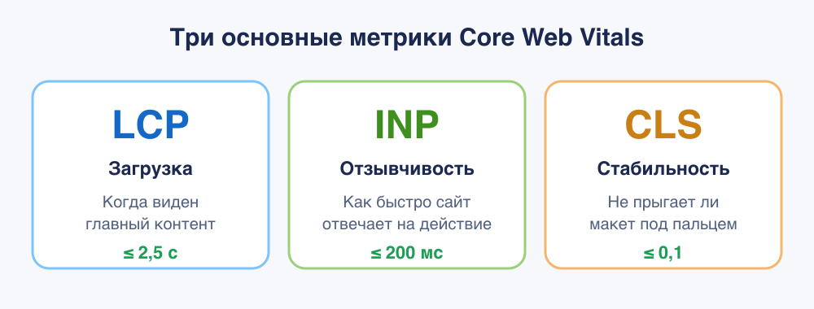
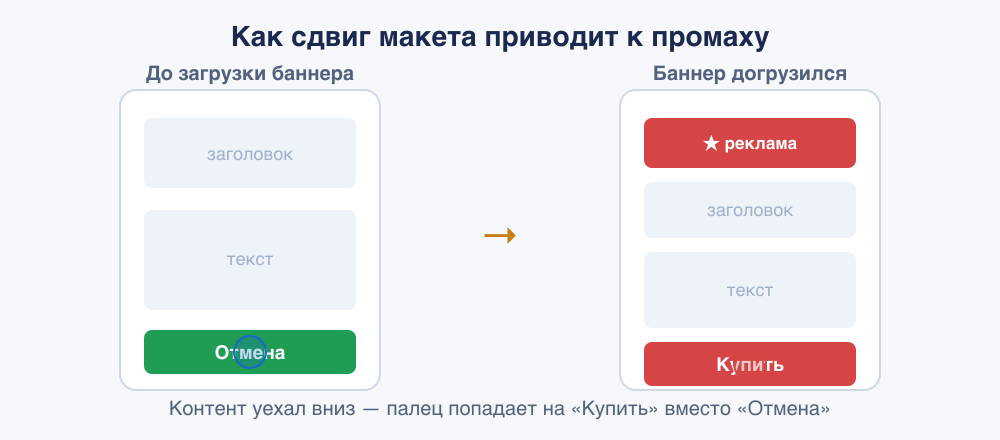
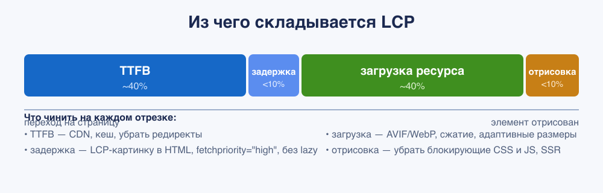

<!--
1. В description есть описание для соцсетей и поисковиков, не больше 200 символов
2. В authors есть ники авторов основного текста
3. В keywords записаны ключевые слова для SEO
4. Удалены все пустые теги в шапке
5. Подпапка автора есть в папке _people/_
6. В related добавлено три ссылки на материалы Доки
-->

## Коротко

Откройте любой сайт. Между кликом по ссылке и моментом, когда страницей реально можно пользоваться, происходит много всего. Сервер думает над ответом. Браузер скачивает и разбирает HTML, тянет картинки и шрифты, выполняет JavaScript. На каждом из этих этапов что-то ломается: страница показывается через пять секунд, текст прыгает под пальцем, кнопка не реагирует на нажатие. Всё это про производительность. И долгое время её было сложно выразить одним понятным числом.

В 2020 году Google предложил набор метрик, которые описывают опыт человека конкретными цифрами, и назвал их **Web Vitals**. Самые важные из них получили статус **Core Web Vitals** («основные»). С 2021 года это уже не просто совет: Core Web Vitals официально влияют на ранжирование в поиске. Если две страницы одинаково подходят под запрос, выше окажется та, что быстрее и стабильнее.

Дальше по порядку: что измеряет каждая метрика, какие у неё пороги, из-за чего она портится и что с этим делать. В конце соберём приёмы для Next.js.

## Зачем Google ввёл эти метрики

У производительности две стороны, и обе важны бизнесу.

**Пользовательский опыт.** Вспомните себя. Сайт тупит на загрузке, текст скачет под пальцем, кнопка не отвечает на тап. Вы закрываете вкладку, не дочитав. Ровно так же ведут себя ваши посетители: чем медленнее и дёрганее страница, тем больше людей уходят, не доскроллив до главного. Медленный сайт приносит меньше просмотров, меньше заказов, меньше денег. Core Web Vitals и придумали, чтобы поймать три главных раздражителя (долгую загрузку, тормоза и прыжки макета) в понятные числа.

**SEO.** Google встроил Core Web Vitals в сигнал ранжирования Page Experience. Причём оценивает не по лабораторным замерам, а по данным реальных пользователей Chrome из отчёта CrUX (Chrome User Experience Report). То есть поисковик смотрит, как сайт ведёт себя на самом деле, на живых телефонах и сетях.

И сразу запомните главное: **все Core Web Vitals считаются по 75-му перцентилю**. Метрика хорошая, только если в порог укладываются 75% посещений. Порадовать быстрый сегмент аудитории и забить на медленный не выйдет: Google смотрит именно на «хвост» распределения, отдельно для мобильных и десктопа.

<aside>

📊 **Core** (основные), это всего три метрики: **LCP**, **INP** и **CLS**. Остальные (**FCP**, **TTFB** и другие), диагностические: они не входят в сигнал ранжирования напрямую, но помогают понять, _почему_ основные метрики проседают.

</aside>



Если на пальцах, три основные метрики отвечают на три простых вопроса:

- **LCP** — «когда я наконец увидел то, ради чего пришёл?»
- **INP** — «я нажал — оно отреагировало или подвисло?»
- **CLS** — «почему всё прыгает и я промахиваюсь мимо кнопок?»

Дальше разберём каждую по очереди.

## Пороговые значения: шпаргалка

Для каждой метрики есть три зоны: «хорошо» (зелёная), «нужно улучшить» (жёлтая) и «плохо» (красная). Запомните эту таблицу, дальше мы будем к ней возвращаться.

| Метрика  | Что измеряет                | 🟢 Хорошо | 🟡 Нужно улучшить | 🔴 Плохо |
| -------- | --------------------------- | --------- | ----------------- | -------- |
| **LCP**  | загрузку основного контента | ≤ 2,5 с   | 2,5–4,0 с         | > 4,0 с  |
| **INP**  | отзывчивость на действия    | ≤ 200 мс  | 200–500 мс        | > 500 мс |
| **CLS**  | визуальную стабильность     | ≤ 0,1     | 0,1–0,25          | > 0,25   |
| **FCP**  | первую отрисовку            | ≤ 1,8 с   | 1,8–3,0 с         | > 3,0 с  |
| **TTFB** | ответ сервера               | ≤ 0,8 с   | 0,8–1,8 с         | > 1,8 с  |

Все пороги считаются для 75-го перцентиля. CLS измеряется в безразмерных единицах, остальные метрики — в секундах или миллисекундах.

## CLS — Cumulative Layout Shift

### Что это

CLS, кумулятивный сдвиг макета, измеряет **визуальную стабильность**. Проще говоря: насколько сильно элементы страницы скачут во время загрузки и использования. Каждый раз, когда блок, который вы уже видите, внезапно прыгает на новое место (и не из-за вашего действия), браузер фиксирует «сдвиг макета». CLS суммирует эти сдвиги за всё время жизни страницы.

Балл одного сдвига считается так: **доля затронутой области экрана × расстояние, на которое уехал контент**. Чем больше площадь и чем дальше прыжок, тем хуже. Знакомая боль: целитесь в кнопку «Отмена», в этот момент сверху догружается баннер, всё уезжает вниз, и палец попадает на «Купить».



### Из-за чего макет прыгает

Больше всего сдвигов дают картинки без размеров. Дальше идут поздно подъезжающие шрифты и динамический контент: реклама, баннеры куки, всплывающие плашки. Полный список причин:

- **Картинки и видео без размеров.** Браузер не знает, сколько места занять, пока файл не догрузится. Поэтому сначала рисует контент вплотную, а потом раздвигает.
- **Реклама, виджеты, эмбеды, iframe** с неизвестной заранее высотой, особенно те, что подгружаются асинхронно.
- **Динамический контент**, вставленный над уже видимым: плашка с куки над текстом, догрузившийся блок рекомендаций, сообщение об ошибке формы.
- **Веб-шрифты.** Пока кастомный шрифт грузится, текст рисуется запасным. Подъезжает кастомный — а у него другая ширина букв и высота строки, и весь текст переверстывается (эффекты FOIT и FOUT).
- **Анимации «не тех» свойств**, когда двигают `top`, `left`, `margin`, `width` вместо `transform`. Такая анимация заставляет браузер пересчитывать раскладку и толкать соседей.

### Как чинить

**Картинки и видео всегда задавайте с размерами.** Указывайте атрибуты `width` и `height` либо CSS-свойство `aspect-ratio`. Тогда браузер заранее зарезервирует место правильной формы.

```html

```

```css
img {
  /* при адаптивной вёрстке размеры из атрибутов сохраняют пропорцию */
  height: auto;
  width: 100%;
}
```

- Для `srcset` следите, чтобы у всех вариантов было **одинаковое соотношение сторон**. Для арт-дирекшена через `<picture>` ставьте `width`/`height` на каждый `<source>`.
- **Резервируйте место под рекламу и эмбеды** заранее: задайте контейнеру `min-height` или `aspect-ratio` под самый вероятный размер. Учитывайте разные размеры на брейкпоинтах через медиазапросы.
- **Не вставляйте контент над уже видимым** без действия пользователя. Если без вставки никак — держите её под линией сгиба или показывайте оверлеем поверх, а не раздвигая.
- Для бесконечной ленты и «Показать ещё» — грузите по кнопке (человек ждёт сдвига), а новый контент подготавливайте за пределами экрана.
- **Оптимизируйте шрифты:** `font-display: optional` не даст переверстать текст при позднем приезде шрифта; метрики `size-adjust`, `ascent-override`, `descent-override`, `line-gap-override` для `@font-face` подгоняют запасной шрифт под кастомный, чтобы при подмене ничего не дёргалось; критичные шрифты предзагружайте через `<link rel="preload">`.
- **Анимируйте через `transform`** (`translate`, `scale`, `rotate`), а не через `top`/`left`/`box-shadow` — `transform` обрабатывается на этапе композитинга и не двигает соседей.
- **Включите bfcache** (back/forward cache): при возврате «назад» страница восстанавливается целиком и мгновенно, без сдвигов.

<aside>

↩️ **Про bfcache стоит сказать отдельно**, он улучшает сразу LCP, FCP и CLS. Это кэш, из которого браузер мгновенно восстанавливает целую страницу при навигации «назад»/«вперёд». Такие переходы, не редкость: примерно **10% навигаций на десктопе и 20% на мобильных**. Восстановленные из bfcache страницы дают почти нулевые LCP, FCP и CLS. Чаще всего bfcache ломают обработчики `unload` (используйте `pagehide`) и заголовок `Cache-Control: no-store` (Chrome постепенно перестаёт его учитывать). Проверить страницу: DevTools → **Application → Back/forward cache → Test**, Chrome покажет список «actionable» проблем, которые можно починить.

</aside>

<aside>

🛠 В DevTools на вкладке Performance есть дорожка **Layout Shifts**, она подсветит, какие именно элементы прыгали и сколько баллов добавили. Очень помогает искать виновника.

</aside>

## LCP — Largest Contentful Paint

### Что это

LCP измеряет момент, когда отрисовался **самый большой видимый элемент** в области экрана, обычно это главная картинка, обложка статьи или крупный блок текста. По сути это ответ на вопрос «когда пользователь увидел то, ради чего пришёл». LCP отражает скорость загрузки лучше, чем общее «страница загрузилась», потому что говорит именно про основной контент.

### Из чего складывается LCP

Чинить LCP вслепую бесполезно, сначала надо понять, какая из четырёх частей виновата. Браузер раскладывает LCP именно на эти четыре отрезка:



1. **TTFB** (~40% времени) — пока сервер не прислал первый байт, не начнётся вообще ничего.
2. **Задержка загрузки ресурса** (<10%) — время между TTFB и началом скачивания LCP-картинки. Сюда попадают проблемы «обнаружения»: браузер поздно узнал, что картинку вообще надо грузить.
3. **Длительность загрузки ресурса** (~40%) — собственно скачивание LCP-файла.
4. **Задержка отрисовки** (<10%) — между «файл скачался» и «элемент показан». Обычно тут виноваты блокирующие CSS и JS.

### Как чинить — по каждой части

**TTFB** (подробно, в разделе про TTFB ниже):

- Уберите лишние редиректы в цепочке до страницы.
- Настройте кеш на CDN, чтобы контент отдавался с ближайшего к пользователю узла.
- Не добавляйте уникальные query-параметры (например, аналитические метки), которые ломают кеш.

**Задержка загрузки ресурса**, чтобы браузер узнал про LCP-картинку как можно раньше:

- **Держите LCP-картинку в HTML** обычным ``, а не подставляйте её JavaScript'ом и не прячьте в `data-src`. Тогда её найдёт preload-сканер ещё до выполнения скриптов.
- **Не используйте `loading="lazy"` на LCP-картинке** — ленивая загрузка откладывает именно то, что должно появиться первым.
- Поставьте **`fetchpriority="high"`** на главную картинку — браузер скачает её раньше остального. Не вешайте `high` больше чем на 1–2 ресурса, иначе приоритет теряет смысл.
- Если LCP-картинка задаётся через CSS `background-image`, браузер не увидит её заранее — **используйте ``** или хотя бы `<link rel="preload" as="image" fetchpriority="high">`.
- Если ресурс на другом домене — добавьте `<link rel="preconnect">`, а лучше держите его на своём origin.

```html
<!-- LCP-картинка: в HTML, с высоким приоритетом, без lazy -->


<!-- если картинка ссылается только из CSS — предзагрузим её -->
<link rel="preload" as="image" href="hero.avif" fetchpriority="high" />

<!-- для адаптивной предзагрузки — imagesrcset/imagesizes -->
<link
  rel="preload"
  as="image"
  imagesrcset="hero-800.avif 800w, hero-1600.avif 1600w"
  imagesizes="100vw"
  fetchpriority="high"
/>
```

<aside>

⚡ `fetchpriority="high"`, самый дешёвый выигрыш по LCP, который существует. По умолчанию картинки в области экрана стартуют с приоритетом Low и повышаются до High только после того, как браузер скачает и разберёт CSS и поймёт, что картинка видима. Атрибут пропускает этот круг. В тесте инженеров Google один этот атрибут улучшил LCP с **2,6 до 1,9 с** (−27%). При этом, по данным Web Almanac 2025, **LCP-картинку предзагружают всего ~2,1% сайтов**, то есть это массово недоиспользованный приём.

</aside>

**Длительность загрузки**, чтобы файл скачался быстрее:

- **Сжимайте и переводите картинки в современные форматы.** Порядок предпочтения: **AVIF** (на ~50% легче JPEG, поддержка ~95%) → **WebP** (на 25–35% легче, поддержка ~96%) → JPEG как фолбэк. Раздавайте через `<picture>` с несколькими `<source>`, чтобы браузер сам выбрал, что умеет.
- **Отдавайте адаптивные размеры** через `srcset`/`sizes` — не грузите 4К-картинку на телефон.
- Используйте **CDN** и **image CDN**, которые на лету подбирают формат и размер.
- Настройте **долгое кеширование** (`Cache-Control` с большим `max-age`) для статики.
- Уберите конкуренцию за полосу: понизьте `fetchpriority` второстепенным ресурсам, отложите сторонние скрипты через `defer`/`async`.

**Задержка отрисовки**, чтобы скачанное сразу показалось:

- **Сократите блокирующий CSS**: вынесите критические стили инлайном, остальное грузите отложенно; удалите неиспользуемые правила (Coverage в DevTools).
- **Уберите блокирующий JS из `<head>`**: переносите вниз `<body>` или вешайте `defer`/`async`.
- **Рендерите на сервере (SSR) или статически (SSG)**, чтобы LCP-контент приехал прямо в HTML, а не дорисовывался скриптом на клиенте.
- Следите, чтобы тяжёлые задачи на главном потоке не блокировали отрисовку сразу после загрузки картинки (см. длинные задачи в разделе про INP).

## INP — Interaction to Next Paint

### Чем INP отличается от FID

До марта 2024 года за отзывчивость отвечала метрика **FID** (First Input Delay). У неё было два больших изъяна: она учитывала только **первое** взаимодействие за всю сессию и мерила лишь **задержку до начала** обработки, игнорируя, сколько времени заняли сам обработчик и отрисовка результата. FID было легко «обмануть».

**INP** пришёл на замену и честнее: он смотрит на **все** клики, тапы и нажатия клавиш за время жизни страницы, берёт (грубо говоря) самое медленное из них и измеряет **полный путь**, от действия пользователя до того момента, когда браузер показал визуальный отклик. Если кнопка «лайк» прокрашивается через 600 мс после тапа, это и есть плохой INP.

### Из чего складывается INP


1. **Задержка ввода (input delay)** — от действия пользователя до запуска обработчика. Растёт, когда главный поток занят чем-то другим (обычно — выполнением JavaScript при загрузке).
2. **Время обработки (processing duration)** — пока выполняются обработчики событий.
3. **Задержка отрисовки (presentation delay)** — от конца обработчиков до показа нового кадра.

### Из-за чего INP проседает

- **Длинные задачи на главном потоке.** Браузер однопоточный для JS: пока выполняется одна задача дольше 50 мс, он не может ответить на нажатие. Это главный враг INP.
- **Тяжёлые обработчики событий**, которые на каждый клик пересчитывают и перерисовывают полстраницы.
- **Layout thrashing** — когда в одном обработчике вы то меняете стили, то читаете геометрию (`offsetHeight` и т. п.), заставляя браузер пересчитывать раскладку снова и снова.
- **Огромный DOM** — чем больше узлов, тем дороже каждая перерисовка.
- **Рендеринг большого HTML на клиенте** — отрисовка большого куска разметки через JS блокирует показ кадра.

### Как улучшать отзывчивость

**Разбивайте длинные задачи и уступайте главный поток.** Главный приём, периодически «отдавать» управление браузеру, чтобы он успел обработать нажатие. Современный способ, `scheduler.yield()`:

```js
async function saveSettings() {
  // То, что важно показать сразу:
  validateForm();
  showSpinner();
  updateUI();

  // Уступаем главный поток — браузер успеет ответить на действия:
  await scheduler.yield();

  // То, что пользователь не видит, — отдельной задачей:
  saveToDatabase();
  sendAnalytics();
}
```

У `scheduler.yield()` есть приятная особенность: продолжение после `await` встаёт в очередь **с приоритетом**, оно выполнится раньше других задач, которые страница успела накидать (в отличие от `setTimeout`, который кидает в конец очереди). Он зарелизился в Chrome 129 (сентябрь 2024), поддержан примерно у 71% браузеров, но **в Safari пока нет**, поэтому делайте фолбэк на `setTimeout`:

```js
function yieldToMain() {
  if (globalThis.scheduler?.yield) {
    return scheduler.yield();
  }
  return new Promise((resolve) => setTimeout(resolve, 0));
}
```

Для обработки больших объёмов данных, режьте работу на пачки и уступайте поток, если задача идёт дольше 50 мс:

```js
async function runJobs(jobQueue, deadline = 50) {
  let lastYield = performance.now();
  for (const job of jobQueue) {
    job();
    if (performance.now() - lastYield > deadline) {
      await yieldToMain();
      lastYield = performance.now();
    }
  }
}
```

Остальные приёмы:

- **Сначала показать, потом досчитать.** В обработчике обновите видимый интерфейс, а тяжёлую работу отложите через `await scheduler.yield()` / `requestAnimationFrame` + `setTimeout`.
- **Выносите тяжёлые вычисления в Web Worker** — он работает в отдельном потоке и не блокирует интерфейс.
- **Дебаунсите частые события** (`input`, `resize`, `scroll`) — не запускайте тяжёлую логику на каждый чих.
- **Грузите меньше JavaScript** — это лечит INP в корне: чем меньше кода выполняется, тем свободнее главный поток. Способов целая россыпь — им посвящён отдельный раздел ниже, «[Размер бандла — это база](#размер-бандла--это-база)».
- **Не делайте layout thrashing** — не читайте геометрию сразу после изменения стилей в той же задаче.
- **Уменьшайте DOM** и применяйте **`content-visibility: auto`**, чтобы браузер не рендерил то, что вне экрана.
- В React используйте конкурентные возможности — **`useTransition`/`useDeferredValue`**, чтобы пометить тяжёлые обновления как несрочные и не блокировать отклик. Конкурентный рендер сам уступает главный поток примерно **каждые 5 мс**, так что срочные взаимодействия (ввод, клики) не ждут медленного рендера.
- В SSR-приложениях **дробите гидратацию через `<Suspense>`**: чем гранулярнее границы, тем меньше компонентов React гидратирует синхронно за раз — главный поток блокируется короче. В React 19.2 для этого же есть `<Activity>` (контент готовится заранее и не «фризит» интерфейс при активации). А **серверные компоненты вообще не гидратируются** — для них шаг гидратации пропускается, и это лучшее, что можно сделать для INP в React.

<aside>

🎯 По данным HTTP Archive, главный убийца INP, **сторонние скрипты**: теги-менеджеры с кучей тегов, A/B-тесты, чаты-виджеты, тепловые карты и аналитика. Они крутятся на главном потоке и блокируют отклик, особенно на мобильных. Выносите их в Web Worker (библиотека **Partytown** или `next/script` со стратегией `worker`), грузите отложенно через `lazyOnload` и выкидывайте то, что не приносит пользы. На реальных проектах перенос Google Tag Manager в воркер снижал TBT до 92%.

</aside>

<aside>

⚠️ Не используйте `isInputPending()` для проверки «не ждёт ли ввод», спека признала её ненадёжной: она может вернуть `false`, хотя пользователь уже нажал. Полагайтесь на `scheduler.yield()`.

</aside>

### Размер бандла — это база

Прежде чем городить `scheduler.yield()` и Web Worker'ы, посмотрите на главный источник проблем: **сколько JavaScript вы вообще отправляете в браузер**. Каждый килобайт скрипта нужно скачать, разобрать и выполнить, и всё это на том самом главном потоке, который потом не успевает ответить на нажатие. Раздутый бандл бьёт сразу по двум метрикам: тормозит интерактивность (INP) и оттягивает отрисовку (LCP). Поэтому работу над производительностью почти всегда правильно начинать именно отсюда.

Способы, по нарастанию усилий:

- **Сначала измерьте.** Не оптимизируйте вслепую — посмотрите, из чего бандл состоит. `webpack-bundle-analyzer` или `@next/bundle-analyzer` рисуют интерактивную карту, где сразу видно самых жирных «нахлебников». Дальше всё просто: измерить → найти самое тяжёлое → заменить или разбить → сжать → поставить бюджет.
- **Делите бандл (code splitting).** Бейте по роутам (каждая страница тащит только своё) и по компонентам. То, что не нужно на первом экране, грузите лениво — через динамический `import()` или `React.lazy`. Тяжёлый график, редактор, модалка, админка — всё это пусть подгружается, когда до него дойдёт дело, а не на старте.
- **Включите tree shaking.** Сборщик выкинет из библиотек неиспользуемый код — но только если импортируете точечно. `import { debounce } from 'lodash-es'` вместо `import _ from 'lodash'`, конкретные функции из `date-fns` вместо целого `moment` (он вообще не «трясётся»). Импорт «всего сразу» убивает tree shaking.
- **Берегитесь barrel-файлов.** Удобный `index.ts`, который реэкспортит всё из папки (`export * from './...'`), часто ломает tree shaking: тянете одну кнопку — приезжает вся UI-библиотека. В Next.js это лечит опция **`optimizePackageImports`** (а для сторонних пакетов — `modularizeImports`): импорты разворачиваются в точечные автоматически.
- **Выносите вычисления на сервер.** Самый жирный клиентский бандл часто делает работу, которой там не место: подсветка кода, рендер Markdown, графики. В App Router это уносится в **серверные компоненты** — на клиент уезжает готовый HTML, а не библиотека.
- **Замените тяжёлые зависимости** на лёгкие аналоги, **сожмите** ответ (Brotli) и поставьте **бюджет размера** в CI, чтобы бандл не распухал незаметно от релиза к релизу.

<aside>

🎯 Главное правило: лучший JavaScript, тот, который вы не отправили. Прежде чем оптимизировать выполнение скрипта, спросите, нужен ли он на этой странице вообще и нельзя ли сделать то же самое разметкой, CSS или на сервере.

</aside>

## FCP — First Contentful Paint

### Что это

FCP, первая отрисовка контента, фиксирует момент, когда на экране появился **хоть какой-то** контент: первый текст, картинка, SVG или непустой `<canvas>`. Это не «страница готова», а «загрузка пошла, пустой белый экран закончился». FCP отлично показывает, как быстро сайт _начинает_ откликаться.

FCP, диагностическая метрика и на ранжирование напрямую не влияет, но это «предшественник» LCP: если плохой FCP, то и LCP почти наверняка плохой.

### Как улучшать

Поскольку FCP стоит в начале цепочки, его лечат тем же, чем начало LCP:

- Убрать блокирующие отрисовку ресурсы, минифицировать CSS, удалить неиспользуемый код.
- Снизить TTFB (см. ниже), добавить `preconnect` к нужным доменам, убрать редиректы.
- Предзагрузить ключевые ресурсы (`preload`), оптимизировать загрузку шрифтов.
- Уменьшить вес страницы, настроить кеширование, не раздувать DOM.

## TTFB — Time to First Byte

### Что это

TTFB измеряет, сколько времени прошло **от начала перехода на страницу до прихода первого байта** ответа сервера. Это самый первый этап, и в этот отрезок «зашито» много всего:

- время редиректов;
- запуск service worker (если есть);
- DNS-резолвинг;
- установка соединения и TLS-рукопожатие;
- обработка запроса на сервере до первого байта ответа.

TTFB важен, потому что **он стоит в начале всего**: пока не пришёл первый байт, браузеру нечего парсить, не из чего рисовать FCP и LCP. Высокий TTFB тянет вниз вообще все метрики.

### Как улучшать

- **CDN** — главное средство. Раздаёт контент с узла, физически близкого к пользователю, и заодно даёт HTTP/2, HTTP/3, TLS 1.3 и воркеры на эдже.
- **Кешируйте HTML на эдже** через `Cache-Control`; настройте инвалидацию кеша при релизах. Избегайте уникальных query-параметров, ломающих кеш.
- **Уберите редиректы.** Каждый 301/302 — это лишний round-trip. Прописывайте правильную схему и слеши; ставьте `Strict-Transport-Security`, чтобы убрать редирект HTTP→HTTPS у повторных посетителей.
- **Стримьте разметку.** Браузеры умеют обрабатывать HTML кусками по мере поступления — используйте серверный стриминг, а где можно — статический рендеринг на этапе сборки.
- **Service worker** со стратегией stale-while-revalidate отдаёт оболочку приложения мгновенно из кеша.
- **103 Early Hints** — сервер успевает подсказать браузеру, какие критичные ресурсы качать, пока бэкенд готовит основной ответ. CDN (например, Cloudflare) умеют отдавать 103 с эджа автоматически. Приём пока почти не распространён (около 0,012% запросов) — это ваше потенциальное преимущество.
- **Современные протоколы** — HTTP/2 и HTTP/3 (QUIC) уменьшают задержки на установке соединения; обычно подключаются на уровне CDN.
- **Бэкенд:** хватает ли памяти, свежий ли софт; меряйте узкие места заголовком `Server-Timing` (запросы к БД, время рендера, попадание в кеш CDN — hit/miss).

## Как измерять и улучшать Core Web Vitals

### Лабораторные данные ≠ полевые

Это самая частая причина недоумения «почему PageSpeed зелёный, а в Search Console красный». Есть два принципиально разных источника данных:

- **Лабораторные (lab)** — синтетический прогон в контролируемых условиях: фиксированное устройство, заданная сеть, **без реального пользователя**. Это Lighthouse и симуляция в PageSpeed Insights.
- **Полевые (field)** — данные реальных пользователей (RUM). Это CrUX и `web-vitals`. Именно их Google учитывает в ранжировании, и показывают они **75-й перцентиль** распределения.

Почему они расходятся:

- **INP в лаборатории не измеряется вообще.** Метрика требует _реального_ взаимодействия в реальный момент, а синтетика не знает, когда и куда нажмёт человек. Lighthouse вместо INP показывает суррогат — TBT (Total Blocking Time), и это лишь приблизительный ориентир.
- **CLS различается.** В лаборатории фиксируется в основном сдвиг при загрузке (верх страницы). В поле — за весь жизненный цикл: пользователь скроллит, догружаются ленивые картинки без размеров, срабатывают A/B-тесты — все эти сдвиги лаборатория не видит.
- **LCP различается.** Разным людям на разных экранах виден разный LCP-элемент; у реальных пользователей часть ресурсов уже в кеше, работает bfcache — в синтетике кеш холодный.

Вывод: **для отладки** удобны лабораторные инструменты (они воспроизводимы и подсказывают, что чинить), а **для приоритизации и оценки результата** доверяйте полевым данным.

<aside>

📅 Ещё одна важная деталь про CrUX: данные собираются **скользящим окном в 28 дней**. Ваш балл, это, по сути, среднее за последние четыре недели. Поэтому после релиза с оптимизациями не ждите, что зелёная зона в Search Console наступит завтра: эффект проявляется постепенно и полностью виден только через ~28 дней. А ещё CrUX различает URL **с учётом query-параметров**, тогда как PageSpeed Insights отрезает параметры и сваливает всё на «голый» URL, отсюда часть расхождений между отчётами.

</aside>

### Инструменты

- **PageSpeed Insights** — даёт и лабораторный прогон (Lighthouse), и полевые данные CrUX за 28 дней, если по сайту хватает трафика. Начинать диагностику удобнее всего отсюда.
- **Lighthouse** (в DevTools, CLI или CI) — лабораторный аудит с конкретными рекомендациями. Помните про оговорку с INP/TBT. **Lighthouse CI** удобно ставить в пайплайн, чтобы ловить регрессии до релиза.
- **Chrome DevTools** — вкладка Performance (дорожка Layout Shifts для CLS, профайл главного потока для INP), панель Performance Insights и Application → Back/forward cache для проверки bfcache.
- **Search Console**, отчёт Core Web Vitals — полевые данные по группам URL прямо в разрезе ранжирования.
- **CrUX Vis** и **CrUX-дашборд / BigQuery** — публичные исторические данные CrUX по вашему домену в разрезе трендов.
- **Сторонние RUM-сервисы** — DebugBear, SpeedCurve, Vercel Speed Insights, RUMVision: в отличие от CrUX, они обновляются мгновенно, работают во всех браузерах (CrUX — только Chrome и без iOS) и дают детальную отладочную атрибуцию, а не «голые» баллы.
- **Библиотека `web-vitals`** — собирает метрики у реальных пользователей и шлёт в вашу аналитику:

```js
import { onCLS, onINP, onLCP, onFCP, onTTFB } from "web-vitals";

function sendToAnalytics(metric) {
  const body = JSON.stringify({
    name: metric.name,
    value: metric.value,
    id: metric.id,
  });
  navigator.sendBeacon("/analytics", body);
}

onCLS(sendToAnalytics);
onINP(sendToAnalytics);
onLCP(sendToAnalytics);
```

У библиотеки есть **attribution-сборка**, она доносит, _что именно_ виновато: для CLS, селектор самого «прыгучего» элемента, для INP, тип взаимодействия и разбивка по фазам, для LCP, какой элемент и из чего сложилось его время.

```js
import { onLCP } from "web-vitals/attribution";

onLCP((metric) => {
  // metric.attribution.element, .url, .timeToFirstByte,
  // .resourceLoadDelay, .resourceLoadDuration, .elementRenderDelay
  console.log(metric.attribution);
});
```

### Подход к работе с метриками

1. **Сначала измерьте на реальных пользователях** (CrUX / `web-vitals`) — поймите, какая из трёх Core-метрик в красной или жёлтой зоне.
2. **Воспроизведите в лаборатории** (Lighthouse, DevTools) и найдите конкретного виновника через attribution.
3. **Чините по разбивке метрики** — не «улучшаем LCP вообще», а «у нас раздут отрезок render delay из-за блокирующего CSS».
4. **Проверьте, что не сломали соседнюю метрику** — например, агрессивный preload всего подряд может ухудшить LCP из-за конкуренции за полосу.
5. **Мониторьте постоянно.** Производительность деградирует незаметно: добавили виджет, обновили зависимость — и метрика поехала. Держите `web-vitals` в проде и следите за трендом.

<aside>

🚫 **Частые ошибки, на которых легко обжечься:**

- **Гнаться за «100 баллами» в Lighthouse.** Балл Performance — лабораторная синтетика; на ранжирование влияют полевые Core Web Vitals. Зелёный PageSpeed при красном Search Console — нормальная ситуация, верьте полю.
- **Ждать мгновенного эффекта.** CrUX — это 28-дневное окно. После фикса метрика в Search Console подтянется неделями, а не за ночь.
- **Оптимизировать не ту метрику.** Сравнивать INP в лабе бессмысленно — там его нет. Сначала смотрите, что реально болит у пользователей.
- **Чинить «среднее».** Метрики оцениваются по 75-му перцентилю — улучшайте «хвост» (медленные устройства и сети), а не и без того быстрый сегмент.
- **Ломать соседнюю метрику.** Запрелоудили всё подряд — получили конкуренцию за полосу и худший LCP. `fetchpriority="high"` — максимум на 1–2 ресурса.

</aside>

## Что дальше: лайфхаки для Next.js

Next.js закрывает большинство кейсов из этой статьи «из коробки», нужно просто пользоваться правильными инструментами.

**`next/image`, против CLS и за LCP.** Компонент `<Image>` требует `width`/`height` (или `fill`) и автоматически резервирует место, CLS из-за картинок исчезает. Ниже линии сгиба он сам включает ленивую загрузку, отдаёт WebP/AVIF и адаптивные размеры. Для **LCP-картинки** ставьте проп **`priority`**, он отключает lazy и поднимает `fetchpriority` до `high`. При статическом импорте `width`/`height` и `blurDataURL` подставляются сами.

```tsx
import Image from "next/image";
import hero from "./hero.png";

// LCP-картинка: priority отключает lazy и грузит её первой
<Image src={hero} alt="Обложка" priority placeholder="blur" />;
```

**`next/font`, против CLS от шрифтов.** Загрузчик self-хостит шрифты (никаких запросов к Google), а главное, автоматически подбирает метрики запасного шрифта (`size-adjust` и компания), давая **нулевой сдвиг макета** при подмене.

```tsx
import { Geist } from "next/font/google";
const geist = Geist({ subsets: ["latin"] });

export default function RootLayout({ children }) {
  return (
    <html className={geist.className}>
      <body>{children}</body>
    </html>
  );
}
```

**Server Components и стриминг, против TTFB и за INP.** Серверные компоненты не отправляют свой JS на клиент, меньше скриптов, меньше длинных задач, лучше INP. Стриминг через `<Suspense>` отдаёт готовую часть страницы сразу, не дожидаясь медленных данных,, улучшает воспринимаемый TTFB и FCP.

**`next/dynamic`, меньше JS при старте.** Грузите тяжёлые клиентские компоненты лениво, чтобы не раздувать начальный бандл и не блокировать главный поток.

```tsx
import dynamic from "next/dynamic";
const HeavyChart = dynamic(() => import("./heavy-chart"), { ssr: false });
```

**`next/script`, управление сторонними скриптами.** Стратегии `beforeInteractive`, `afterInteractive` (по умолчанию), `lazyOnload` и `worker` решают, _когда_ грузить аналитику и виджеты, чтобы они не мешали интерактивности.

**SSG / ISR, минимальный TTFB.** Статическая генерация и инкрементальная регенерация отдают готовый HTML с CDN, TTFB и LCP получаются отличными почти даром.

**`useReportWebVitals`, встроенный мониторинг.** Хук из `next/web-vitals` собирает все метрики у реальных пользователей. Выносите его в отдельный клиентский компонент, чтобы не тащить `'use client'` на весь layout:

```tsx
"use client";
import { useReportWebVitals } from "next/web-vitals";

const report = (metric) =>
  navigator.sendBeacon("/analytics", JSON.stringify(metric));

export function WebVitals() {
  useReportWebVitals(report);
  return null;
}
```

## Что в итоге

Core Web Vitals, это попытка выразить «удобно ли пользоваться сайтом» в трёх числах: **LCP** (быстро ли появилось главное), **INP** (живо ли реагирует) и **CLS** (не прыгает ли под пальцами). Плюс диагностические **FCP** и **TTFB**, которые подсказывают, где искать причину.

Главные мысли:

1. Все основные метрики оцениваются **по 75-му перцентилю реальных пользователей** — лабораторного «зелёного» недостаточно.
2. Не чините метрику целиком — **разбирайте её на составляющие** и бейте по конкретному отрезку.
3. **Доверяйте полевым данным** (CrUX, `web-vitals`) для приоритетов, лабораторным — для отладки.
4. Производительность деградирует тихо — **мониторьте постоянно**, а не разово перед релизом.

Хорошие Core Web Vitals, это не про красивый отчёт в PageSpeed, а про людей, которые не уходят с сайта и доходят до цели. И заодно про то, что Google показывает вас выше конкурентов.

## На практике

<details>
  <summary>Пример</summary>

🛠 Самый частый «быстрый выигрыш» по LCP, который я вижу на проектах,, это lazy-loading на главной картинке. Команда включает «ленивую загрузку для всех изображений» одним правилом, радуется, что below-the-fold картинки больше не грузятся сразу,, и не замечает, что под это правило попала и обложка. В итоге браузер откладывает загрузку именно того элемента, по которому считается LCP, и метрика проседает на ровном месте.

Лечится в одну строку: на LCP-картинку, `fetchpriority="high"` и никакого `loading="lazy"`. В Next.js это просто проп `priority` на `<Image>`. После такой правки LCP нередко падает с 4+ секунд до 2,5, без единой строчки на бэкенде.

</details>

<details>
  <summary>Кейсы из жизни: цифры до и после</summary>

🛠 Чтобы было понятно, что речь не про «попугаев в PageSpeed», а про реальный эффект,, вот несколько разобранных кейсов с командами, которые чинили именно Core Web Vitals на Next.js:

- **Контентный блог.** Тяжёлые hero-картинки и поздние шрифты давали LCP 4,2 с, INP 350 мс и CLS 0,28 (всё в красной зоне). Лечение по учебнику: `next/image` для LCP, `next/dynamic` для INP, `next/font` для CLS. Результат — **LCP 1,9 с, INP 150 мс, CLS 0,02**, и сайт поднялся в выдаче на 23 позиции.
- **Интернет-магазин.** Перевели hero-картинку с PNG на AVIF, добавили предзагрузку и перешли на статическую генерацию (SSG) — **LCP упал с 4,8 с до 1,9 с**, органический трафик вырос на 23% за восемь недель.
- **SaaS-лендинг.** INP был 450 мс из-за перегруженной аналитики. Заменили тяжёлый трекинг на лёгкий и добавили code splitting — **INP 120 мс**, конверсия выросла на 15%.

Общий вывод по всем кейсам один: самые жирные выигрыши дают не «магические» оптимизации, а базовые правила из этой статьи, размеры картинок, современные форматы, контроль сторонних скриптов и правильный рендеринг. И только ~47% сайтов в 2025-м проходят пороги Google, так что это ещё и способ обогнать конкурентов.

</details>

## Источники

**Официальная документация, пороги, метрики и API:**

- web.dev: [Web Vitals](https://web.dev/articles/vitals), [Optimize LCP](https://web.dev/articles/optimize-lcp), [Optimize INP](https://web.dev/articles/optimize-inp), [Optimize CLS](https://web.dev/articles/optimize-cls), [Optimize TTFB](https://web.dev/articles/optimize-ttfb), [Optimize long tasks](https://web.dev/articles/optimize-long-tasks), [Preload responsive images](https://web.dev/articles/preload-responsive-images), [Back/forward cache](https://web.dev/articles/bfcache), [Lab and field data differences](https://web.dev/articles/lab-and-field-data-differences).
- Chrome for Developers: [Use `scheduler.yield()`](https://developer.chrome.com/blog/use-scheduler-yield), [Test back/forward cache](https://developer.chrome.com/docs/devtools/application/back-forward-cache), [Enabling bfcache for `Cache-Control: no-store`](https://developer.chrome.com/docs/web-platform/bfcache-ccns), [INP in frameworks](https://developer.chrome.com/docs/aurora/inp-in-frameworks).
- MDN: [Fix your website's LCP by optimizing image loading](https://developer.mozilla.org/en-US/blog/fix-image-lcp/), [`Scheduler.yield()`](https://developer.mozilla.org/en-US/docs/Web/API/Scheduler/yield).
- Google: [Understanding Core Web Vitals and search results](https://developers.google.com/search/docs/appearance/core-web-vitals), [Core Web Vitals report (Search Console)](https://support.google.com/webmasters/answer/9205520), [About PageSpeed Insights](https://developers.google.com/speed/docs/insights/v5/about).
- Addy Osmani: [Use `fetchpriority=high` to load your LCP hero image sooner](https://addyosmani.com/blog/fetch-priority/).
- [Web Almanac 2025 — CDN](https://almanac.httparchive.org/en/2025/cdn), HTTP Archive.

**Библиотека и фреймворк:**

- [Библиотека `web-vitals`](https://github.com/GoogleChrome/web-vitals), GoogleChrome.
- Next.js: [Image Optimization](https://nextjs.org/docs/app/getting-started/images), [Font Optimization](https://nextjs.org/docs/app/getting-started/fonts), [`useReportWebVitals`](https://nextjs.org/docs/app/api-reference/functions/use-report-web-vitals).
- [React 19.2 Further Advances INP Optimization](https://calendar.perfplanet.com/2025/react-19-2-further-advances-inp-optimization/), Web Performance Calendar.
- [Guides: Package Bundling](https://nextjs.org/docs/app/guides/package-bundling) и [How we optimized package imports in Next.js](https://vercel.com/blog/how-we-optimized-package-imports-in-next-js), Next.js / Vercel.

**Размер бандла:**

- [8 Ways to Optimize Your JavaScript Bundle Size](https://about.codecov.io/blog/8-ways-to-optimize-your-javascript-bundle-size/), Codecov.
- [webpack-bundle-analyzer](https://github.com/webpack/webpack-bundle-analyzer), GitHub.
- [Why you should avoid Barrel Files in JavaScript Modules](https://laniewski.me/blog/pitfalls-of-barrel-files-in-javascript-modules/).
- [Progressive Hydration](https://www.patterns.dev/react/progressive-hydration/), patterns.dev.

**Инструменты, мониторинг и измерение:**

- DebugBear: [9 Core Web Vitals monitoring tools](https://www.debugbear.com/software/core-web-vitals-monitoring-tools), [CrUX vs RUM](https://www.debugbear.com/blog/crux-vs-rum), [Fixing layout shifts caused by web fonts](https://www.debugbear.com/blog/web-font-layout-shift), [`scheduler.yield`: a beginner's guide](https://www.debugbear.com/blog/scheduler-yield), [Partytown + web workers](https://www.debugbear.com/blog/partytown-web-workers).
- corewebvitals.io: [Yield to the main thread to improve INP](https://www.corewebvitals.io/pagespeed/yield-to-main-thread), [Fix slow hero images](https://www.corewebvitals.io/pagespeed/fix-slow-hero-images-core-web-vitals).

**Разборы и кейсы из практики:**

- [Core Web Vitals Optimization: INP, LCP, CLS Guide 2025](https://www.digitalapplied.com/blog/core-web-vitals-optimization-guide-2025), digitalapplied.
- [Case Study: Optimizing Core Web Vitals in a Next.js Content Blog](https://www.wellally.tech/blog/nextjs-core-web-vitals-case-study), wellally.tech.
- [How to Optimize Core Web Vitals in Next.js App Router for 2025](https://makersden.io/blog/optimize-web-vitals-in-nextjs-2025), Makers' Den.
- [Third-Party Scripts Are Killing Your Core Web Vitals](https://www.pagespeedfix.com/blog/third-party-scripts-core-web-vitals/), PageSpeedFix.
- [Image Optimization for Website Speed: The 2026 Playbook](https://logoswebdesigns.com/blog/image-optimization-website-speed-2026/), Logos Web Designs.
- [How to Fix Cumulative Layout Shift (CLS) in 2025](https://natclark.com/how-to-fix-cumulative-layout-shift-cls-in-2025/), Natclark.
