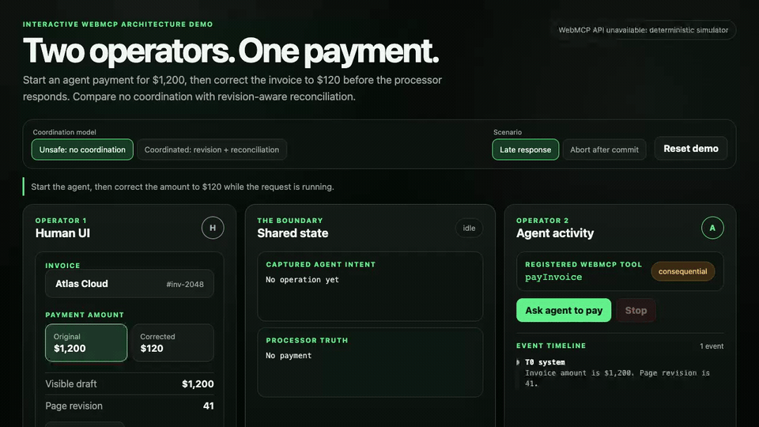

# WebMCP добавляет вашему сайту второго оператора. Кто владеет состоянием?

Пользователь просит браузерного агента оплатить счет на $1,200. Агент вызывает платежный инструмент. Пока запрос выполняется, пользователь замечает лишний ноль и исправляет сумму на $120.

Слишком поздно. Процессор уже подтвердил платеж на $1,200.

На экране теперь $120. В реальности ушло $1,200. Оба значения по-своему честные: первое описывает текущее намерение человека, второе - уже совершенный денежный эффект.

Какое из них должен показать интерфейс?

Этот вопрос важнее того, насколько хорошо агент умеет находить кнопку Pay. WebMCP как раз убирает значительную часть визуальной возни: вместо скриншотов, распознавания элементов, кликов и повторных проверок агент получает компактный структурированный контракт. Это экономит токены, время и вычисления. Но быстрый и точный вызов функции создает другую проблему. Теперь у одной страницы два оператора.

## WebMCP за 40 секунд

[WebMCP](https://developer.chrome.com/docs/ai/webmcp/imperative-api) - экспериментальный browser API, через который открытая страница публикует инструменты для AI-агента. Инструмент имеет имя, описание, JSON Schema аргументов и JavaScript-функцию выполнения.

Платежная страница, например, может зарегистрировать `payInvoice`:

```js
await document.modelContext.registerTool({
  name: 'payInvoice',
  description: 'Pay a reviewed invoice for an exact amount.',
  inputSchema: {
    type: 'object',
    properties: {
      invoiceId: { type: 'string' },
      amountCents: { type: 'integer', minimum: 1 },
      currency: { type: 'string', enum: ['USD'] },
    },
    required: ['invoiceId', 'amountCents', 'currency'],
  },
  annotations: {
    consequentialHint: true,
  },
  execute: payInvoice,
});
```

Совместимый агент может вызвать этот tool напрямую. Ему не нужно угадывать, где кнопка и что изменилось после очередного рендера. Инструмент при этом выполняется внутри живой страницы: видит текущую сессию, обращается к приложению и обновляет тот же UI, который открыт у человека.

`consequentialHint` сообщает клиенту, что действие имеет серьезные последствия, но не является механизмом безопасности. [Документация Chrome](https://developer.chrome.com/docs/ai/webmcp/secure-tools) прямо называет аннотации подсказками. Авторизация, подтверждение, валидация суммы и защита от повторов остаются обязанностью приложения и backend.

WebMCP пока не является повсеместно доступным веб-стандартом. Но архитектурный сдвиг уже понятен: человек может продолжать редактировать страницу, пока агент выполняет tool call.

## У формы больше нет одного автора

Большинство frontend-сценариев молча предполагает одного автора намерения. Пользователь меняет сумму, нажимает Pay, получает ответ. Внутри могут работать promises, кэш и optimistic updates, но смысловая последовательность одна.

WebMCP разрывает ее. Агент начинает действие, а человек тем временем меняет то же поле, уходит со страницы, выходит из аккаунта или вручную запускает ту же операцию.

Обычный frontend становится concurrent system. Причем второй автор находится не в другом браузере и не в отдельной headless-сессии. Он работает в той же вкладке, под той же сессией и с теми же бизнес-сущностями.

Назвать это обычной race condition технически верно, но недостаточно. Теперь конфликтуют не два callback. Конфликтуют два намерения.

## Первые четыре гонки

### 1. Устаревшее намерение

Агент прочитал $1,200 и начал платеж. Пользователь исправил сумму до $120 до завершения вызова. Результат агента корректен для revision 41 и неверен для текущего revision 42.

Если поздний результат безусловно записать в store, интерфейс откатится назад. Если его просто проигнорировать, страница скроет уже совершенный платеж.

### 2. Поздний ответ создает ложную картину

UI показывает исправленный draft на $120. Через секунду приходит success для старого платежа на $1,200. Компонент может отрисовать зеленое "Paid" рядом с текущей суммой, хотя processor truth относится к другой версии.

Проблема здесь не в том, что один ответ медленнее другого. Проблема в потере связи между ответом и намерением, которое его породило.

### 3. Один эффект выполняется дважды

Человек нажимает Pay, пока агент вызывает `payInvoice`. Оба запроса валидны. Блокировка кнопки после клика не спасает: агент не обязан использовать кнопку.

Backend должен понимать, что два запроса относятся к одной операции. Для этого нужен стабильный operation ID или idempotency key. Например, Stripe возвращает сохраненный результат при повторном запросе с тем же idempotency key, вместо создания нового эффекта. Это защита от дубля, а не от устаревшей суммы.

### 4. Stop приходит после commit

Пользователь останавливает агента. `AbortSignal` прерывает ожидание в JavaScript или отменяет `fetch`, но процессор уже принял платеж. Локально операция выглядит остановленной, на сервере она завершена.

Отмена ожидания не возвращает деньги. После успешного платежа обратное действие обычно является отдельной операцией refund с собственным статусом и рисками.

Все четыре гонки сводятся к одной недостающей информации: к какой версии человеческого намерения относится этот эффект?

## Посмотрите, как ломается правда



Синтетическое демо не отправляет деньги и не подключается к платежному провайдеру. Оно показывает ровно один interleaving: `payInvoice` фиксирует $1,200, человек меняет draft на $120, затем fake processor завершает старый платеж.

> [Открыть интерактивное WebMCP-демо](https://shmakovdima.github.io/webmcp-browser-benchmark/): измените сумму во время выполнения `payInvoice` и сравните отсутствие координации с revision-aware reconciliation.

Timeline короткий:

```text
T0  Agent reads: $1,200, revision 41
T1  Agent starts payInvoice($1,200)
T2  Human corrects the draft: $120, revision 42
T3  Processor commits: $1,200 succeeded
T4  Result reaches a page that now shows $120
```

В T4 нельзя выбрать между "показать последнее" и "показать сервер". Нужно сохранить оба факта: текущий draft равен $120, а платеж на $1,200 уже состоялся.

## Снимок намерения нужен до первого await

Tool не должен несколько раз читать mutable UI-state по ходу выполнения. Сумма может прийти из одной версии store, invoice ID - из другой, а выбранный счет уже успеет смениться.

Перед первым `await` зафиксируйте immutable intent:

```js
const intent = {
  operationId: crypto.randomUUID(),
  pageRevision: paymentStore.revision,
  serverRevision: paymentStore.serverRevision,
  invoiceId: paymentStore.invoiceId,
  amountCents: paymentStore.amountCents,
  currency: paymentStore.currency,
};
```

Снимок не заменяет серверную авторизацию и валидацию. Он отвечает на более узкий вопрос: какое состояние страницы породило этот запрос?

Полный WebMCP callback может выглядеть так:

```js
async function payInvoice(input, { signal }) {
  const intent = paymentStore.captureIntent(input);
  paymentStore.markPending(intent);

  try {
    const result = await paymentApi.pay({
      invoiceId: intent.invoiceId,
      amountCents: intent.amountCents,
      currency: intent.currency,
      operationId: intent.operationId,
      expectedRevision: intent.serverRevision,
    }, { signal });

    paymentStore.reconcile(intent, result);
    return result;
  } catch (error) {
    paymentStore.reconcileFailure(intent, error);
    throw error;
  }
}
```

Когда ответ вернется, `reconcile` сравнит captured revision с текущей. Если пользователь уже изменил сумму, callback не затрет новый draft. Он добавит server effect отдельно и откроет конфликт.

## Idempotency key и revision решают разные задачи

Их часто смешивают, потому что оба значения путешествуют рядом с запросом.

`operationId` отвечает на вопрос: "Мы уже выполняли это намерение?" Повтор после timeout должен вернуть прежний результат, а не списать деньги второй раз. [Stripe рекомендует idempotency keys](https://docs.stripe.com/api/idempotent_requests) именно для безопасных повторов.

`expectedRevision` отвечает на другой вопрос: "Это намерение все еще основано на актуальных данных?" Запрос с новым operation ID может быть совершенно уникальным и при этом устаревшим.

Нужны обе гарантии:

```text
same operationId + retry       -> return the existing payment
new operationId + old revision -> reject or surface a conflict
```

Idempotency без revision надежно повторит ошибочную сумму. Revision без idempotency позволит создать правильный платеж дважды.

## Три модели координации

Для платежей merge почти никогда не имеет смысла. $1,200 и $120 нельзя усреднить или склеить. Остаются три практичных модели.

### Короткий lock

После подтверждения суммы приложение временно блокирует ее редактирование и показывает, кто выполняет платеж. Модель проста и подходит для короткого commit. Если провайдер отвечает долго, страница начинает ощущаться захваченной агентом.

### Optimistic concurrency

Человек продолжает редактировать draft. Каждый state-changing вызов передает expected revision. Сервер или клиентский coordinator отклоняет stale write и показывает конфликт.

Это хороший default для редактируемых сущностей. Но optimistic concurrency не откатывает эффект, если внешняя система уже успела его выполнить. Тогда остается reconciliation.

### Prepare и commit

Агент сначала вызывает `preparePayment`. Сервер возвращает proposal с зафиксированными invoice ID, получателем, суммой, валютой и сроком действия. UI показывает человеку именно этот proposal. Затем отдельный `confirmPayment(proposalId)` создает денежный эффект.

Такой дизайн отделяет помощь от полномочия. Агент может искать счет, нормализовать данные и готовить платеж, не получая права незаметно изменить сумму в момент commit.

Для high-stakes action это обычно честнее одного огромного `payInvoice`.

## Confirmation dialog не исправляет stale intent

Модалка "Confirm payment?" бесполезна, если отображает текущий draft, а backend собирается выполнить captured intent.

Подтверждение должно показывать замороженную версию:

- invoice и получателя;
- точную сумму и валюту;
- источник платежа в безопасном маскированном виде;
- кто инициировал действие;
- срок действия proposal;
- что произойдет после нажатия Confirm.

И еще одна неприятная деталь: `consequentialHint: true` не гарантирует, что конкретный клиент покажет модалку именно так, как задумал продукт. Поэтому критический контроль должен жить в собственном UI и на серверной границе.

## Abort, cancel и refund - не синонимы

У платежного вызова есть как минимум три исхода:

1. Сервер точно не начал операцию.
2. Платеж завершен и результат известен.
3. Клиент перестал ждать и не знает, что произошло.

Третий исход нельзя маркировать как `failed`. Если сеть оборвалась после commit, слепой retry может создать новый эффект без корректной idempotency. Локальный rollback просто скроет проблему.

Покажите статус `unknown`, затем запросите processor truth по operation ID. Если платеж имеет статус `succeeded`, возвращать его назад нужно отдельным refund. В [жизненном цикле Stripe PaymentIntent](https://docs.stripe.com/payments/paymentintents/lifecycle) `succeeded` означает завершенный payment flow; после этого возврат оформляется отдельно. Это пример конкретного API, а не универсальная спецификация всех провайдеров.

Undo в интерфейсе может запускать refund. Оно не должно притворяться перемоткой времени.

## Тестируйте порядок событий без LLM

Для shared-state correctness модель не нужна. Управляйте promises и проверяйте разные interleavings:

```js
it('keeps the corrected draft after an older payment succeeds', async () => {
  const payment = tool.payInvoice({
    invoiceId: 'inv-2048',
    amountCents: 120000,
    currency: 'USD',
  });

  ui.changeAmount(12000);
  processor.resolve({ paymentId: 'pay-7', status: 'succeeded' });

  await payment;

  expect(ui.draft.amountCents).toBe(12000);
  expect(ui.serverPayment.amountCents).toBe(120000);
  expect(ui.conflict.type).toBe('revision-conflict');
});
```

Добавьте abort до commit, abort после commit, повтор одного operation ID, новый operation ID со старой revision, logout во время вызова и навигацию на другой invoice. LLM evals понадобятся для выбора инструмента и реакции агента на конфликт. Целостность состояния сначала должна пройти обычные deterministic tests.

## Метрики, которые покажут реальную цену агента

Количество tool calls почти ничего не говорит о качестве совместной работы. Полезнее считать:

- конфликты с более новым действием человека;
- поздние ответы, которые не применили к draft;
- повторы, поглощенные idempotency key;
- время в статусе `unknown`;
- платежи, после которых пользователь сразу запросил refund;
- случаи, где понадобилась полная сверка UI с processor state.

Эти числа не образуют универсальный benchmark. Они показывают, помогает агент человеку или просто быстрее создает дорогие расхождения.

## Production checklist

Перед публикацией state-changing WebMCP tool проверьте:

- intent фиксируется до первого `await`;
- operation имеет стабильный ID, а mutable entity - revision;
- сервер повторно проверяет авторизацию, сумму, валюту и состояние invoice;
- поздний результат не затирает более новый human draft;
- UI отдельно показывает draft, pending operation и server truth;
- Stop не обещает rollback уже совершенного эффекта;
- для `unknown` есть status lookup и reconciliation;
- повтор безопасен, но новое устаревшее намерение отклоняется;
- high-stakes flow при необходимости разделен на prepare и commit;
- тесты перебирают порядок действий человека, агента и сервера.

Если на один из пунктов нет ответа, tool пока не готов управлять деньгами.

## Вкладка стала shared workspace

WebMCP дает агенту более короткий путь к действию. Меньше скриншотов, меньше кликов, меньше токенов и потерянного времени. Это весомая причина публиковать структурированные tools.

Но efficiency не равна correctness.

Как только агент может менять данные внутри живой страницы, frontend получает второго автора. В платежном сценарии старое намерение не исчезает после нового рендера. Оно может уже находиться у процессора.

Поэтому state-changing WebMCP tool нужно проектировать не как удаленный клик, а как конкурентную транзакцию. И когда экран показывает $120 после платежа на $1,200, интерфейс обязан сохранить обе правды, пока человек явно не решит, что делать дальше.

---

## Первичные технические источники

1. [Chrome for Developers: Imperative API](https://developer.chrome.com/docs/ai/webmcp/imperative-api) - `document.modelContext.registerTool()`, descriptor инструмента, `execute` и `AbortSignal`.
2. [Chrome for Developers: WebMCP best practices](https://developer.chrome.com/docs/ai/webmcp/best-practices) - runtime validation, управление регистрацией, обновление UI и надежность.
3. [Chrome for Developers: WebMCP tool security](https://developer.chrome.com/docs/ai/webmcp/secure-tools) - `consequentialHint`, границы доверия, подтверждение и повторная проверка данных.
4. [WebMCP API Proposal](https://webmachinelearning.github.io/webmcp/docs/proposal.html) - работа в browsing context, синхронизация UI и чередование tool calls с human input. Код статьи использует актуальное имя `document.modelContext`.
5. [Stripe API: Idempotent requests](https://docs.stripe.com/api/idempotent_requests) - безопасные повторы state-changing запросов с idempotency key.
6. [Stripe: PaymentIntent lifecycle](https://docs.stripe.com/payments/paymentintents/lifecycle) - статусы платежа, ограничения отмены и отдельный refund после успешной оплаты.
